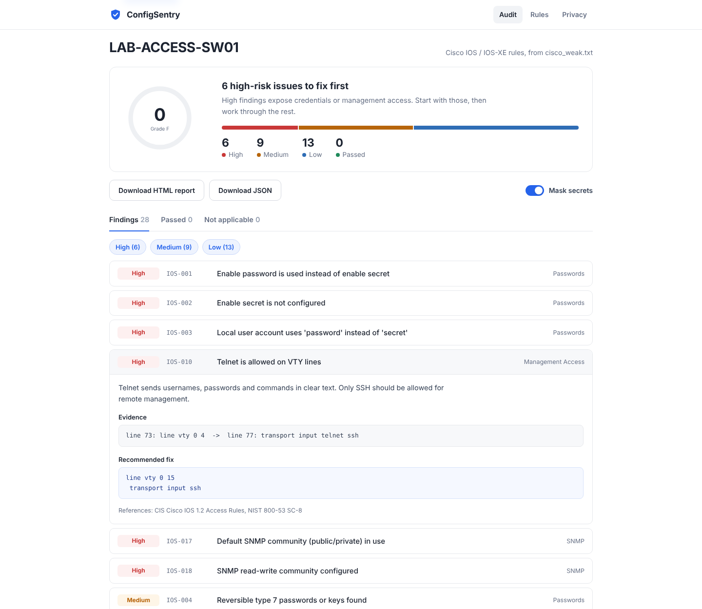
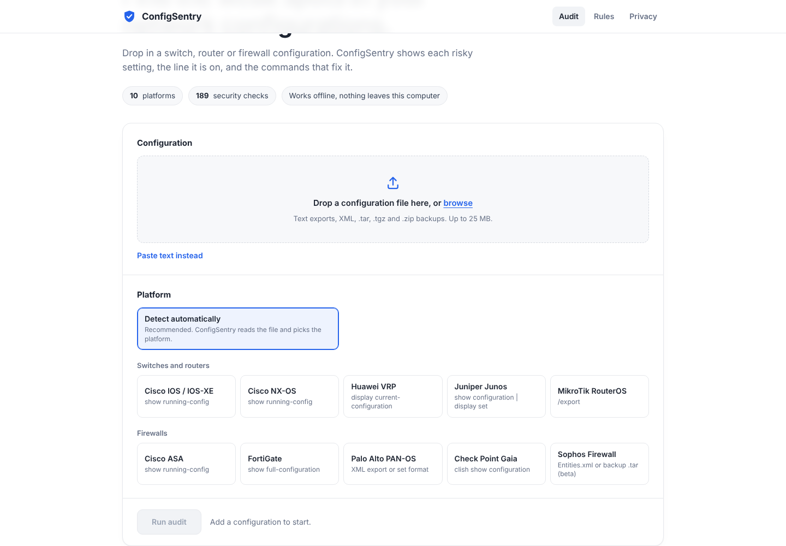
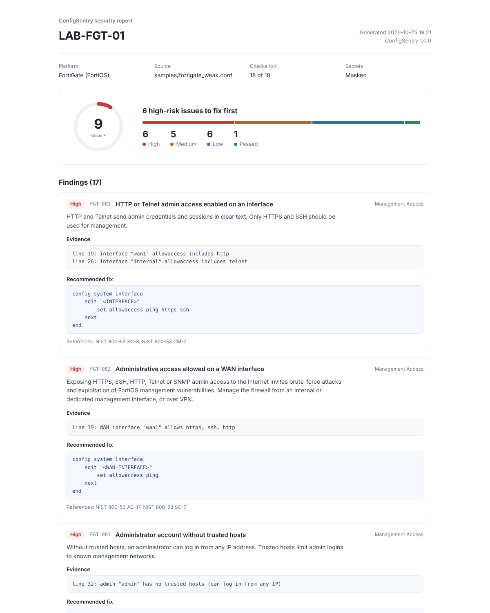

# 🛡️ ConfigSentry

**Open-source security auditor for switch, router and firewall configurations.**

Upload or paste a device configuration (for example `show running-config` or `display current-configuration`).
ConfigSentry works completely offline: it never connects to your devices. It checks the configuration against hardening best practices and gives you a clear report:
what is weak, why it matters, the exact lines, and the commands to fix it.




---

## Features

- **Clean local web app**: drag and drop a file, automatic platform detection, and a searchable list of every rule
- **Offline by design**: upload or paste a config; the tool never logs in to a device and never needs device passwords
- **Folder mode**: audit a whole folder of backups (e.g. Oxidized or RANCID) in one command
- **189 checks across 10 platforms**: 5 switch/router operating systems and 5 firewalls (see below)
- **Many input formats**: text configs, Junos and PAN-OS `set` or `{ }` format, PAN-OS and Sophos XML, and `.tar` / `.zip` backups (opened in memory)
- **Auto-detection**: warns you if the config does not match the selected platform
- **Every finding includes** a severity, evidence with line numbers, a description, fix commands, and NIST 800-53 references (plus CIS Benchmark references where a benchmark exists)
- **Security score** (0-100) and grade
- **Reports**: HTML (print to PDF) and JSON
- **Secrets are masked** in results and reports by default
- **CI-friendly CLI**: `--fail-on high` returns exit code 1 so you can block risky configs in a pipeline
- **Rules in YAML**: add a check without writing Python

## Supported platforms

**Switches and routers**

| Platform | What to upload | Rules |
|---|---|---|
| Cisco IOS / IOS-XE | `show running-config` | 28 |
| Cisco NX-OS (Nexus) | `show running-config` | 17 |
| Huawei VRP (S / CE switches, AR routers) | `display current-configuration` | 27 |
| Juniper Junos (EX / QFX / MX / SRX) | `show configuration \| display set` (or the default `{ }` format) | 20 |
| MikroTik RouterOS (v6 / v7) | `/export` | 13 |

**Firewalls**

| Platform | What to upload | Rules |
|---|---|---|
| Cisco ASA (9.x) | `show running-config` | 19 |
| FortiGate (FortiOS 6.4 / 7.x) | `show` or `show full-configuration` | 18 |
| Palo Alto PAN-OS (9.x - 11.x) | XML config export, or `show config running` (set or `{ }` format) | 18 |
| Check Point Gaia (R80 / R81) | clish `show configuration` (OS hardening only) | 17 |
| Sophos Firewall SFOS (v18 - v21) **beta** | `Entities.xml`, or the `.tar` from *Backup & firmware > Import export* | 12 |

See the full list in [docs/RULES.md](docs/RULES.md).

**What it checks:** clear-text and weak passwords, password policy and lockout, AAA, Telnet/HTTP/FTP management access, management ACLs and trusted hosts, WAN exposure of admin services, weak SSH ciphers and TLS versions, session timeouts, SNMP communities and versions, logging and NTP, unneeded services (CDP, UPnP, SOCKS, MAC server, ...), BPDU Guard, DHCP snooping, OSPF authentication, any-any firewall rules, rule logging and security profiles, and more.

## Quick start

Requires Python 3.10 or newer.

**Easiest (Windows):** download or clone the repo and double-click **`start.bat`**.
It creates a virtual environment, installs the requirements and opens the UI.
On Linux or macOS run `./start.sh` (see [Linux](#linux) below).

**Manual:**

```bash
git clone https://github.com/Piriyangan/ConfigSentry.git
cd ConfigSentry
python -m venv .venv
# Windows: .venv\Scripts\activate     Linux/macOS: source .venv/bin/activate
pip install -r requirements.txt
python run.py
```

Your browser opens ConfigSentry at `http://localhost:8501` (or the next free port).

1. Select the vendor/OS.
2. Upload or paste the configuration.
3. Click **Run audit**, then review the findings and download the report.

Try it with the fake sample configs in [`samples/`](samples/).



## Linux

ConfigSentry is plain Python, so it runs the same on Linux (Ubuntu, Debian, RHEL, Rocky and others) and macOS.

```bash
# Ubuntu / Debian prerequisites (RHEL / Rocky: sudo dnf install python3 git)
sudo apt install python3 python3-venv git

git clone https://github.com/Piriyangan/ConfigSentry.git
cd ConfigSentry
./start.sh
```

On a Linux desktop the browser opens automatically. On a **server without a desktop**, the web app still
listens on `localhost` only, which is safer. Reach it from your PC through an SSH tunnel:

```bash
# on your PC, then open http://localhost:8501 in your browser
ssh -L 8501:localhost:8501 user@your-server
```

Options: `./start.sh --port 9000` uses another port, and `./start.sh --no-browser` does not open a browser.

### Scheduled audits (no web app needed)

The command line is ideal for servers. For example, audit your Oxidized or RANCID backups every night
and keep the reports:

```bash
# crontab -e
0 2 * * * cd /opt/ConfigSentry && .venv/bin/python -m configsentry audit --folder /var/lib/oxidized/configs --out-dir /var/www/configsentry/$(date +\%F)
```

Each run writes one HTML report per device plus `summary.csv`. Use `--fail-on high` in CI pipelines to fail a
build when a config has high-risk findings.

## Command line

```bash
# Audit a file (platform is auto-detected)
python -m configsentry audit -f samples/cisco_weak.txt -o report.html

# Audit a folder of backups; writes one report per device plus summary.csv
python -m configsentry audit --folder ./backups --out-dir ./reports

# Choose the platform yourself
python -m configsentry audit -p huawei_vrp -f samples/huawei_weak.cfg -o report.html

# Archives work too (the config inside is read in memory)
python -m configsentry audit -p sophos -f backup.tar -o report.html

# Use in CI: exit code 1 if any High finding exists
python -m configsentry audit -f config.txt --fail-on high

# List rules
python -m configsentry rules -p huawei_vrp
```

## Sample report



## Security and privacy

ConfigSentry handles sensitive data, so it is designed to be safe by default:

- **Offline.** ConfigSentry never connects to network devices, so it never needs device credentials.
- **Runs locally.** The web app is a small built-in Python server that listens on `127.0.0.1` only and rejects requests for any other host name. It sends strict security headers (CSP, no framing). No config or report leaves your machine, and there is no analytics.
- **Nothing is stored.** Configs stay in memory for the session only. Nothing is written to disk unless you save a report.
- **Secrets are masked.** Passwords, hashes, keys and SNMP communities are replaced with `****` in evidence and reports (you can turn this off).

> ⚠️ Only audit devices you own or are authorised to assess. Never commit real configurations to a public repository.

## Limitations

- Checks are based on the configuration text only. They do not test the live behaviour of the device.
- FortiGate `show` hides default values. ConfigSentry uses the FortiOS defaults for those settings, so paste the **full** configuration, not a single section.
- Some checks depend on your design (for example, CDP on internal links). Review each finding in context.
- MikroTik `/export` hides default settings and does not include users, so ConfigSentry uses the RouterOS defaults and does not check user accounts.
- Check Point Gaia `show configuration` covers the OS only. The firewall rulebase lives on the Management Server and is not checked.
- Sophos support is **beta**: XML tag names vary between SFOS versions. Settings that are not found are marked *Not applicable*.
- CIS references name the benchmark (and the section for Cisco IOS and ASA). Check the exact recommendation number for your benchmark version. Huawei VRP and MikroTik have no CIS Benchmark, so those rules use NIST 800-53 references.

## Project structure

```
ConfigSentry/
├── run.py                  # Starts the web app
├── start.bat / start.sh    # One-click start (Windows / Linux, macOS)
├── configsentry/
│   ├── parsers.py          # Config parsers for all platforms, auto-detection, archive reading
│   ├── engine.py           # Rule engine, scoring, platforms
│   ├── checks.py           # Custom Python checks
│   ├── masking.py          # Secret masking
│   ├── report.py           # HTML / JSON / terminal output
│   ├── cli.py              # Command-line interface
│   ├── server.py           # Local web server and JSON API (standard library only)
│   ├── web/                # Web app: HTML, CSS and JavaScript (no external libraries)
│   ├── rules/              # YAML rule packs (one per platform)
│   └── templates/          # HTML report template
├── samples/                # Fake weak and hardened configs
├── tests/                  # pytest tests
└── docs/                   # Rule list and screenshots
```

## Roadmap

- [x] Huawei VRP, Cisco NX-OS, Juniper Junos, MikroTik RouterOS
- [x] Cisco ASA, Palo Alto PAN-OS, Check Point Gaia, Sophos Firewall (beta)
- [ ] Aruba AOS-CX and Arista EOS rule packs
- [ ] CIS FortiGate Benchmark mapping
- [ ] Unused switchport and VLAN checks
- [ ] Docker image

## Contributing

Contributions are welcome, especially new rules and new platforms. See [CONTRIBUTING.md](CONTRIBUTING.md).
Most rules are a few lines of YAML.

## Disclaimer

ConfigSentry is provided as is, without warranty. It supports, but does not replace, a professional security assessment.
Always test recommended changes in a lab or maintenance window before applying them in production.

## Author

**Piriyangan K** — Senior Network & Security Engineer
[LinkedIn](https://linkedin.com/in/piriyangan)

## License

[MIT](LICENSE)
